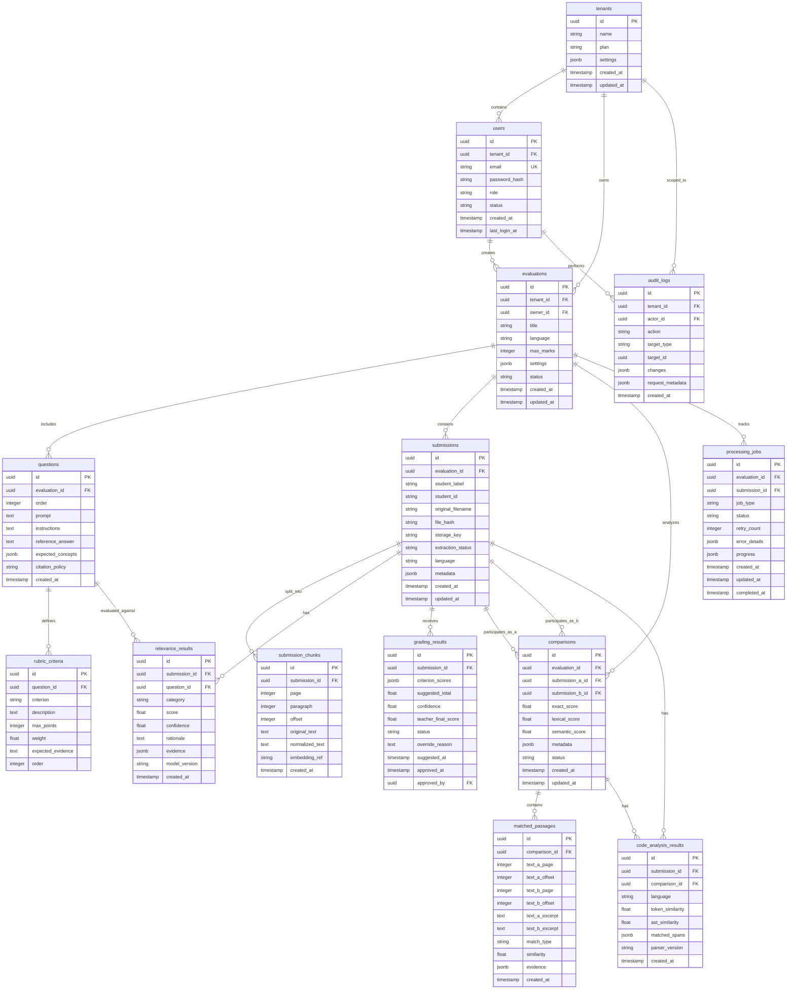

# Data Model

**PLAGIX v1.0**  
**Status:** Architecture planning  
**Last updated:** 16 November 2026

---

## Purpose

This document defines the database schema, entity relationships, key indexes, and constraints for PLAGIX. It ensures data integrity, tenant isolation, and efficient query performance.

---

## Entity Relationship Diagram



---

## Table Definitions

### 1. `tenants`

Multi-tenant boundary and workspace configuration.

| Column | Type | Constraints | Description |
|--------|------|-------------|-------------|
| `id` | UUID | PRIMARY KEY | Unique tenant identifier |
| `name` | VARCHAR(255) | NOT NULL | Tenant/organization name |
| `plan` | VARCHAR(50) | NOT NULL DEFAULT 'free' | Subscription plan |
| `settings` | JSONB | NOT NULL DEFAULT '{}' | Tenant-specific configuration |
| `created_at` | TIMESTAMPTZ | NOT NULL DEFAULT NOW() | Creation timestamp |
| `updated_at` | TIMESTAMPTZ | NOT NULL DEFAULT NOW() | Last update timestamp |

**Indexes:**
- PRIMARY KEY on `id`

---

### 2. `users`

Teacher and admin accounts.

| Column | Type | Constraints | Description |
|--------|------|-------------|-------------|
| `id` | UUID | PRIMARY KEY | Unique user identifier |
| `tenant_id` | UUID | NOT NULL, FOREIGN KEY → tenants(id) | Owner tenant |
| `email` | VARCHAR(255) | NOT NULL, UNIQUE | Login email |
| `password_hash` | VARCHAR(255) | NOT NULL | Bcrypt/Argon2 hashed password |
| `role` | VARCHAR(50) | NOT NULL DEFAULT 'teacher' | Role: teacher, admin |
| `status` | VARCHAR(50) | NOT NULL DEFAULT 'active' | active, suspended, deleted |
| `created_at` | TIMESTAMPTZ | NOT NULL DEFAULT NOW() | Account creation timestamp |
| `last_login_at` | TIMESTAMPTZ | | Last successful login |

**Indexes:**
- PRIMARY KEY on `id`
- UNIQUE on `email`
- INDEX on `tenant_id`

**Constraints:**
- Foreign key `tenant_id` references `tenants(id)` ON DELETE CASCADE

---

### 3. `evaluations`

One evaluation job = one question set + batch of submissions.

| Column | Type | Constraints | Description |
|--------|------|-------------|-------------|
| `id` | UUID | PRIMARY KEY | Unique evaluation identifier |
| `tenant_id` | UUID | NOT NULL, FOREIGN KEY → tenants(id) | Owner tenant |
| `owner_id` | UUID | NOT NULL, FOREIGN KEY → users(id) | Teacher who created evaluation |
| `title` | VARCHAR(255) | NOT NULL | Evaluation name |
| `language` | VARCHAR(10) | NOT NULL DEFAULT 'en' | Expected language (en, bn) |
| `max_marks` | INTEGER | NOT NULL | Maximum possible marks |
| `settings` | JSONB | NOT NULL DEFAULT '{}' | Grading policy, thresholds, feature flags |
| `status` | VARCHAR(50) | NOT NULL DEFAULT 'created' | Workflow state (see state machine) |
| `created_at` | TIMESTAMPTZ | NOT NULL DEFAULT NOW() | Creation timestamp |
| `updated_at` | TIMESTAMPTZ | NOT NULL DEFAULT NOW() | Last update timestamp |

**Indexes:**
- PRIMARY KEY on `id`
- INDEX on `tenant_id, owner_id`
- INDEX on `status`

**Constraints:**
- Foreign key `tenant_id` references `tenants(id)` ON DELETE CASCADE
- Foreign key `owner_id` references `users(id)` ON DELETE RESTRICT

---

### 4. `questions`

Questions and sub-questions within an evaluation.

| Column | Type | Constraints | Description |
|--------|------|-------------|-------------|
| `id` | UUID | PRIMARY KEY | Unique question identifier |
| `evaluation_id` | UUID | NOT NULL, FOREIGN KEY → evaluations(id) | Parent evaluation |
| `order` | INTEGER | NOT NULL | Display order for sub-questions |
| `prompt` | TEXT | NOT NULL | Question/sub-question text |
| `instructions` | TEXT | | Teacher instructions for grading |
| `reference_answer` | TEXT | | Optional reference answer for relevance |
| `expected_concepts` | JSONB | | List of expected concepts/keywords |
| `citation_policy` | VARCHAR(100) | | none, optional, required |
| `created_at` | TIMESTAMPTZ | NOT NULL DEFAULT NOW() | Creation timestamp |

**Indexes:**
- PRIMARY KEY on `id`
- INDEX on `evaluation_id, order`

**Constraints:**
- Foreign key `evaluation_id` references `evaluations(id)` ON DELETE CASCADE
- UNIQUE on `(evaluation_id, order)`

---

### 5. `rubric_criteria`

Rubric criteria for structured grading.

| Column | Type | Constraints | Description |
|--------|------|-------------|-------------|
| `id` | UUID | PRIMARY KEY | Unique criterion identifier |
| `question_id` | UUID | NOT NULL, FOREIGN KEY → questions(id) | Parent question |
| `criterion` | VARCHAR(255) | NOT NULL | Criterion name |
| `description` | TEXT | | Detailed description |
| `max_points` | INTEGER | NOT NULL | Maximum points for this criterion |
| `weight` | FLOAT | NOT NULL DEFAULT 1.0 | Weighting factor |
| `expected_evidence` | TEXT | | What to look for in answers |
| `order` | INTEGER | NOT NULL | Display order |

**Indexes:**
- PRIMARY KEY on `id`
- INDEX on `question_id, order`

**Constraints:**
- Foreign key `question_id` references `questions(id)` ON DELETE CASCADE

---

### 6. `submissions`

One student's uploaded answer file.

| Column | Type | Constraints | Description |
|--------|------|-------------|-------------|
| `id` | UUID | PRIMARY KEY | Unique submission identifier |
| `evaluation_id` | UUID | NOT NULL, FOREIGN KEY → evaluations(id) | Parent evaluation |
| `student_label` | VARCHAR(255) | NOT NULL | Derived or teacher-provided student name/ID |
| `student_id` | VARCHAR(100) | | Optional canonical student ID |
| `original_filename` | VARCHAR(500) | NOT NULL | Original uploaded filename |
| `file_hash` | VARCHAR(64) | NOT NULL | SHA-256 hash for deduplication |
| `storage_key` | VARCHAR(500) | NOT NULL | Object storage key |
| `extraction_status` | VARCHAR(50) | NOT NULL DEFAULT 'pending' | pending, completed, partial, failed, needs_ocr |
| `language` | VARCHAR(10) | | Detected or declared language |
| `metadata` | JSONB | NOT NULL DEFAULT '{}' | File size, MIME type, pages, etc. |
| `created_at` | TIMESTAMPTZ | NOT NULL DEFAULT NOW() | Upload timestamp |
| `updated_at` | TIMESTAMPTZ | NOT NULL DEFAULT NOW() | Last update timestamp |

**Indexes:**
- PRIMARY KEY on `id`
- INDEX on `evaluation_id`
- INDEX on `file_hash`
- INDEX on `extraction_status`

**Constraints:**
- Foreign key `evaluation_id` references `evaluations(id)` ON DELETE CASCADE
- UNIQUE on `(evaluation_id, file_hash)` to prevent duplicate uploads

---

### 7. `submission_chunks`

Extracted text chunks with page/offset for evidence tracing.

| Column | Type | Constraints | Description |
|--------|------|-------------|-------------|
| `id` | UUID | PRIMARY KEY | Unique chunk identifier |
| `submission_id` | UUID | NOT NULL, FOREIGN KEY → submissions(id) | Parent submission |
| `page` | INTEGER | NOT NULL | Page number (1-indexed) |
| `paragraph` | INTEGER | NOT NULL | Paragraph within page |
| `offset` | INTEGER | NOT NULL | Character offset from document start |
| `original_text` | TEXT | NOT NULL | Original extracted text |
| `normalized_text` | TEXT | NOT NULL | Normalized for comparison (lowercased, punctuation-stripped) |
| `embedding_ref` | VARCHAR(255) | | Optional reference to stored embedding (Phase 4) |
| `created_at` | TIMESTAMPTZ | NOT NULL DEFAULT NOW() | Extraction timestamp |

**Indexes:**
- PRIMARY KEY on `id`
- INDEX on `submission_id, page, paragraph`

**Constraints:**
- Foreign key `submission_id` references `submissions(id)` ON DELETE CASCADE

---

### 8. `relevance_results`

Answer relevance evaluation results.

| Column | Type | Constraints | Description |
|--------|------|-------------|-------------|
| `id` | UUID | PRIMARY KEY | Unique result identifier |
| `submission_id` | UUID | NOT NULL, FOREIGN KEY → submissions(id) | Evaluated submission |
| `question_id` | UUID | NOT NULL, FOREIGN KEY → questions(id) | Evaluated against question |
| `category` | VARCHAR(50) | NOT NULL | relevant, partially_relevant, off_topic, uncertain |
| `score` | FLOAT | | Optional numeric score (0.0-1.0) |
| `confidence` | FLOAT | | Model confidence (0.0-1.0) |
| `rationale` | TEXT | | Human-readable explanation |
| `evidence` | JSONB | | Supporting answer excerpts |
| `model_version` | VARCHAR(100) | NOT NULL | Model/prompt version for reproducibility |
| `created_at` | TIMESTAMPTZ | NOT NULL DEFAULT NOW() | Analysis timestamp |

**Indexes:**
- PRIMARY KEY on `id`
- UNIQUE on `(submission_id, question_id)`
- INDEX on `category`

**Constraints:**
- Foreign key `submission_id` references `submissions(id)` ON DELETE CASCADE
- Foreign key `question_id` references `questions(id)` ON DELETE CASCADE

---

### 9. `comparisons`

**CRITICAL:** Canonical pairwise comparison results with uniqueness constraint.

| Column | Type | Constraints | Description |
|--------|------|-------------|-------------|
| `id` | UUID | PRIMARY KEY | Unique comparison identifier |
| `evaluation_id` | UUID | NOT NULL, FOREIGN KEY → evaluations(id) | Parent evaluation |
| `submission_a_id` | UUID | NOT NULL, FOREIGN KEY → submissions(id) | First submission (a < b) |
| `submission_b_id` | UUID | NOT NULL, FOREIGN KEY → submissions(id) | Second submission (a < b) |
| `exact_score` | FLOAT | | Exact/near-exact match score (0.0-1.0) |
| `lexical_score` | FLOAT | | TF-IDF cosine similarity (0.0-1.0) |
| `semantic_score` | FLOAT | | Embedding cosine similarity (0.0-1.0) |
| `metadata` | JSONB | NOT NULL DEFAULT '{}' | Algorithm versions, thresholds |
| `status` | VARCHAR(50) | NOT NULL DEFAULT 'pending' | pending, completed, failed |
| `created_at` | TIMESTAMPTZ | NOT NULL DEFAULT NOW() | Comparison timestamp |
| `updated_at` | TIMESTAMPTZ | NOT NULL DEFAULT NOW() | Last update timestamp |

**Indexes:**
- PRIMARY KEY on `id`
- **UNIQUE on `(evaluation_id, submission_a_id, submission_b_id)`** ← **CANONICAL PAIR CONSTRAINT**
- INDEX on `evaluation_id, status`

**Constraints:**
- Foreign key `evaluation_id` references `evaluations(id)` ON DELETE CASCADE
- Foreign key `submission_a_id` references `submissions(id)` ON DELETE CASCADE
- Foreign key `submission_b_id` references `submissions(id)` ON DELETE CASCADE
- **CHECK constraint:** `submission_a_id < submission_b_id` (enforce canonical ordering)

**Application Logic:**
```python
def get_canonical_pair_ids(sub_a_id: UUID, sub_b_id: UUID) -> tuple[UUID, UUID]:
    """Always return (smaller_id, larger_id) for canonical storage."""
    return (sub_a_id, sub_b_id) if sub_a_id < sub_b_id else (sub_b_id, sub_a_id)
```

---

### 10. `matched_passages`

Specific text fragments identified as similar between submissions.

| Column | Type | Constraints | Description |
|--------|------|-------------|-------------|
| `id` | UUID | PRIMARY KEY | Unique passage identifier |
| `comparison_id` | UUID | NOT NULL, FOREIGN KEY → comparisons(id) | Parent comparison |
| `text_a_page` | INTEGER | | Page in submission A |
| `text_a_offset` | INTEGER | | Character offset in submission A |
| `text_b_page` | INTEGER | | Page in submission B |
| `text_b_offset` | INTEGER | | Character offset in submission B |
| `text_a_excerpt` | TEXT | NOT NULL | Matched text from submission A |
| `text_b_excerpt` | TEXT | NOT NULL | Matched text from submission B |
| `match_type` | VARCHAR(50) | NOT NULL | exact, near_exact, lexical, semantic |
| `similarity` | FLOAT | NOT NULL | Match strength (0.0-1.0) |
| `evidence` | JSONB | | Algorithm-specific metadata |
| `created_at` | TIMESTAMPTZ | NOT NULL DEFAULT NOW() | Detection timestamp |

**Indexes:**
- PRIMARY KEY on `id`
- INDEX on `comparison_id`

**Constraints:**
- Foreign key `comparison_id` references `comparisons(id)` ON DELETE CASCADE

---

### 11. `code_analysis_results`

Code similarity analysis results (Phase 4).

| Column | Type | Constraints | Description |
|--------|------|-------------|-------------|
| `id` | UUID | PRIMARY KEY | Unique result identifier |
| `submission_id` | UUID | FOREIGN KEY → submissions(id) | Single submission analysis (optional) |
| `comparison_id` | UUID | FOREIGN KEY → comparisons(id) | Pairwise code comparison (optional) |
| `language` | VARCHAR(50) | NOT NULL | python, cpp, java, javascript, etc. |
| `token_similarity` | FLOAT | | Token n-gram similarity |
| `ast_similarity` | FLOAT | | Abstract syntax tree similarity |
| `matched_spans` | JSONB | | Matched code regions with line numbers |
| `parser_version` | VARCHAR(100) | NOT NULL | Parser/tool version |
| `created_at` | TIMESTAMPTZ | NOT NULL DEFAULT NOW() | Analysis timestamp |

**Indexes:**
- PRIMARY KEY on `id`
- INDEX on `submission_id`
- INDEX on `comparison_id`

**Constraints:**
- Foreign key `submission_id` references `submissions(id)` ON DELETE CASCADE
- Foreign key `comparison_id` references `comparisons(id)` ON DELETE CASCADE
- CHECK constraint: `(submission_id IS NOT NULL) OR (comparison_id IS NOT NULL)`

---

### 12. `grading_results`

Provisional and final marks with teacher overrides.

| Column | Type | Constraints | Description |
|--------|------|-------------|-------------|
| `id` | UUID | PRIMARY KEY | Unique result identifier |
| `submission_id` | UUID | NOT NULL, FOREIGN KEY → submissions(id) | Graded submission |
| `criterion_scores` | JSONB | NOT NULL | Rubric criterion breakdown |
| `suggested_total` | FLOAT | NOT NULL | System-suggested total marks |
| `confidence` | FLOAT | | Confidence in suggested marks |
| `teacher_final_score` | FLOAT | | Teacher-approved final marks |
| `status` | VARCHAR(50) | NOT NULL DEFAULT 'pending' | pending, reviewed, approved |
| `override_reason` | TEXT | | Teacher explanation for changes |
| `suggested_at` | TIMESTAMPTZ | NOT NULL DEFAULT NOW() | System suggestion timestamp |
| `approved_at` | TIMESTAMPTZ | | Teacher approval timestamp |
| `approved_by` | UUID | FOREIGN KEY → users(id) | Teacher who approved |

**Indexes:**
- PRIMARY KEY on `id`
- UNIQUE on `submission_id`
- INDEX on `status`

**Constraints:**
- Foreign key `submission_id` references `submissions(id)` ON DELETE CASCADE
- Foreign key `approved_by` references `users(id)` ON DELETE SET NULL

---

### 13. `processing_jobs`

Background job tracking and retry management.

| Column | Type | Constraints | Description |
|--------|------|-------------|-------------|
| `id` | UUID | PRIMARY KEY | Unique job identifier |
| `evaluation_id` | UUID | FOREIGN KEY → evaluations(id) | Parent evaluation (optional) |
| `submission_id` | UUID | FOREIGN KEY → submissions(id) | Target submission (optional) |
| `job_type` | VARCHAR(50) | NOT NULL | ingestion, extraction, relevance, comparison, grading, report |
| `status` | VARCHAR(50) | NOT NULL DEFAULT 'queued' | queued, processing, completed, failed |
| `retry_count` | INTEGER | NOT NULL DEFAULT 0 | Number of retry attempts |
| `error_details` | JSONB | | Error message, stack trace |
| `progress` | JSONB | | Current progress metadata |
| `created_at` | TIMESTAMPTZ | NOT NULL DEFAULT NOW() | Job creation timestamp |
| `updated_at` | TIMESTAMPTZ | NOT NULL DEFAULT NOW() | Last status update |
| `completed_at` | TIMESTAMPTZ | | Completion timestamp |

**Indexes:**
- PRIMARY KEY on `id`
- INDEX on `evaluation_id, job_type, status`
- INDEX on `status, created_at`

**Constraints:**
- Foreign key `evaluation_id` references `evaluations(id)` ON DELETE CASCADE
- Foreign key `submission_id` references `submissions(id)` ON DELETE CASCADE

---

### 14. `audit_logs`

Immutable audit trail for sensitive operations.

| Column | Type | Constraints | Description |
|--------|------|-------------|-------------|
| `id` | UUID | PRIMARY KEY | Unique log identifier |
| `tenant_id` | UUID | NOT NULL, FOREIGN KEY → tenants(id) | Tenant scope |
| `actor_id` | UUID | FOREIGN KEY → users(id) | User who performed action |
| `action` | VARCHAR(100) | NOT NULL | create_evaluation, upload_file, override_marks, delete_evaluation, etc. |
| `target_type` | VARCHAR(50) | NOT NULL | evaluation, submission, comparison, grade |
| `target_id` | UUID | NOT NULL | ID of affected entity |
| `changes` | JSONB | | Before/after values for changes |
| `request_metadata` | JSONB | | IP address, user agent, request ID |
| `created_at` | TIMESTAMPTZ | NOT NULL DEFAULT NOW() | Action timestamp |

**Indexes:**
- PRIMARY KEY on `id`
- INDEX on `tenant_id, created_at DESC`
- INDEX on `actor_id, created_at DESC`
- INDEX on `target_type, target_id`

**Constraints:**
- Foreign key `tenant_id` references `tenants(id)` ON DELETE RESTRICT (preserve audit trail)
- Foreign key `actor_id` references `users(id)` ON DELETE SET NULL (preserve log even if user deleted)

---

## Key Design Decisions

### 1. Canonical Pair Storage

**Problem:** N submissions require N×(N-1)/2 unique comparisons. A-B and B-A must resolve to the same result.

**Solution:**
- Store exactly one row per unordered pair
- Enforce canonical ordering: `submission_a_id < submission_b_id`
- Database unique constraint on `(evaluation_id, submission_a_id, submission_b_id)`
- Application logic always canonicalizes IDs before insert/query

**Benefits:**
- Prevents duplicate comparisons
- Ensures symmetric similarity (A-B = B-A)
- Simplifies retry logic (idempotent inserts)
- Reduces storage by 50%

---

### 2. Tenant Isolation

**Strategy:**
- Every user, evaluation, submission, comparison, and audit log has a `tenant_id`
- API middleware validates tenant access on every request
- Database queries always filter by `tenant_id` first
- Object storage keys prefixed with `tenant_id`

**Enforcement:**
- Foreign key constraints cascade tenant deletions appropriately
- Row-level security policies (optional, can be added in production)
- Admin role requires elevated authentication to access cross-tenant data

---

### 3. Soft Delete vs. Hard Delete

**Approach:**
- **Soft delete:** Add `deleted_at` timestamp, filter in queries (not implemented in MVP)
- **Hard delete:** Actual row deletion with cascading foreign keys (MVP approach)
- **Audit logs:** Never delete; use ON DELETE RESTRICT for tenant reference

**Rationale:**
- MVP uses hard delete with audit trail preservation
- Soft delete can be added in Phase 5 for data retention compliance

---

### 4. JSONB for Flexibility

**Use cases:**
- `settings`: Tenant/evaluation configuration (thresholds, feature flags)
- `metadata`: File properties, algorithm parameters
- `evidence`: Relevance excerpts, matched passage details
- `criterion_scores`: Rubric breakdown (variable number of criteria)
- `changes`: Audit log before/after values

**Benefits:**
- Schema flexibility without migrations for every new setting
- Efficient querying with PostgreSQL JSONB operators
- Preserves complex nested structures

**Caution:**
- Don't abuse JSONB for relational data (use proper tables)
- Index JSONB fields when frequently queried

---

### 5. UUID Primary Keys

**Rationale:**
- Globally unique, no collision risk across tenants
- No sequential enumeration risk (security)
- Distributed-friendly (future sharding)
- Standard in modern SaaS applications

**Tradeoff:**
- Larger index size than integer keys (acceptable for this scale)

---

## Indexes and Performance

### Critical Indexes (MVP)
```sql
-- Tenant isolation queries
CREATE INDEX idx_users_tenant_id ON users(tenant_id);
CREATE INDEX idx_evaluations_tenant_owner ON evaluations(tenant_id, owner_id);
CREATE INDEX idx_audit_logs_tenant_time ON audit_logs(tenant_id, created_at DESC);

-- Evaluation workflow
CREATE INDEX idx_submissions_evaluation ON submissions(evaluation_id);
CREATE INDEX idx_submissions_hash ON submissions(file_hash);
CREATE INDEX idx_comparisons_evaluation_status ON comparisons(evaluation_id, status);

-- Evidence tracing
CREATE INDEX idx_submission_chunks_submission_page ON submission_chunks(submission_id, page, paragraph);
CREATE INDEX idx_matched_passages_comparison ON matched_passages(comparison_id);

-- Job processing
CREATE INDEX idx_processing_jobs_status_time ON processing_jobs(status, created_at);
CREATE INDEX idx_processing_jobs_eval_type_status ON processing_jobs(evaluation_id, job_type, status);

-- Uniqueness constraints (also serve as indexes)
CREATE UNIQUE INDEX idx_comparisons_canonical_pair ON comparisons(evaluation_id, submission_a_id, submission_b_id);
CREATE UNIQUE INDEX idx_relevance_results_unique ON relevance_results(submission_id, question_id);
CREATE UNIQUE INDEX idx_grading_results_submission ON grading_results(submission_id);
CREATE UNIQUE INDEX idx_users_email ON users(email);
```

### Future Indexes (Phase 4+)
```sql
-- Semantic search with pgvector
CREATE INDEX idx_submission_chunks_embedding ON submission_chunks USING ivfflat (embedding vector_cosine_ops);

-- Advanced filtering
CREATE INDEX idx_submissions_language ON submissions(language);
CREATE INDEX idx_relevance_results_category ON relevance_results(category);
```

---

## Constraints Summary

### Foreign Key Cascades
- **ON DELETE CASCADE:** Child data deleted when parent deleted
  - `users.tenant_id → tenants.id`
  - `evaluations.tenant_id → tenants.id`
  - `submissions.evaluation_id → evaluations.id`
  - `comparisons.evaluation_id → evaluations.id`
  - `matched_passages.comparison_id → comparisons.id`

- **ON DELETE RESTRICT:** Prevent deletion if children exist
  - `evaluations.owner_id → users.id` (can't delete user with active evaluations)
  - `audit_logs.tenant_id → tenants.id` (preserve audit trail)

- **ON DELETE SET NULL:** Preserve record but clear reference
  - `grading_results.approved_by → users.id`
  - `audit_logs.actor_id → users.id`

### Check Constraints
- `comparisons.submission_a_id < comparisons.submission_b_id` (canonical ordering)
- `code_analysis_results`: At least one of `submission_id` or `comparison_id` must be NOT NULL
- `rubric_criteria.max_points >= 0`
- `evaluations.max_marks > 0`

### Unique Constraints
- `(evaluation_id, submission_a_id, submission_b_id)` on `comparisons` ← **CRITICAL**
- `(submission_id, question_id)` on `relevance_results`
- `(evaluation_id, file_hash)` on `submissions`
- `email` on `users`

---

## Data Retention and Deletion

### Deletion Workflow
1. Teacher requests evaluation deletion
2. System marks evaluation for deletion in audit log
3. Cascade deletes:
   - Submissions → submission_chunks, relevance_results, grading_results
   - Comparisons → matched_passages
   - Processing jobs
4. Background job deletes files from object storage
5. Audit logs preserved indefinitely (or per retention policy)

### Retention Policy (Configurable)
- **Immediate deletion:** Allowed for test evaluations
- **30-day retention:** Default for production evaluations
- **Compliance hold:** Legal/institutional requirements may extend retention

---

## Migration Strategy

### Phase 1 (MVP)
- Core tables: users, tenants, evaluations, questions, rubric_criteria, submissions, submission_chunks
- Relevance: relevance_results
- Comparison: comparisons, matched_passages
- Grading: grading_results
- Operations: processing_jobs, audit_logs

### Phase 4 (Advanced)
- Add: code_analysis_results
- Add: embedding_ref column to submission_chunks
- Add: pgvector extension and indexes

### Future
- Add: student_portal tables (students, feedback, appeals)
- Add: subscription and billing tables
- Add: soft delete columns (deleted_at)

---

## Example Queries

### 1. Get all submissions for an evaluation with relevance status
```sql
SELECT 
    s.id, 
    s.student_label, 
    s.extraction_status,
    rr.category AS relevance_category,
    rr.score AS relevance_score
FROM submissions s
LEFT JOIN relevance_results rr ON rr.submission_id = s.id
WHERE s.evaluation_id = $1
  AND s.extraction_status = 'completed'
ORDER BY s.student_label;
```

### 2. Get top 10 highest similarity pairs in an evaluation
```sql
SELECT 
    c.id,
    sa.student_label AS student_a,
    sb.student_label AS student_b,
    c.lexical_score,
    c.semantic_score
FROM comparisons c
JOIN submissions sa ON sa.id = c.submission_a_id
JOIN submissions sb ON sb.id = c.submission_b_id
WHERE c.evaluation_id = $1
  AND c.status = 'completed'
ORDER BY c.lexical_score DESC
LIMIT 10;
```

### 3. Get canonical comparison result (handles A-B and B-A)
```sql
WITH canonical_ids AS (
    SELECT 
        CASE WHEN $1 < $2 THEN $1 ELSE $2 END AS a_id,
        CASE WHEN $1 < $2 THEN $2 ELSE $1 END AS b_id
)
SELECT c.*
FROM comparisons c, canonical_ids
WHERE c.evaluation_id = $3
  AND c.submission_a_id = canonical_ids.a_id
  AND c.submission_b_id = canonical_ids.b_id;
```

### 4. Audit trail for grade changes
```sql
SELECT 
    al.created_at,
    u.email AS actor,
    al.action,
    al.changes->>'suggested_total' AS old_marks,
    al.changes->>'teacher_final_score' AS new_marks,
    al.changes->>'override_reason' AS reason
FROM audit_logs al
JOIN users u ON u.id = al.actor_id
WHERE al.target_type = 'grading_result'
  AND al.target_id = $1
ORDER BY al.created_at DESC;
```

---

## References

- [PLAGIX SRS v1.0](../PLAGIX_SRS_v1.0.pdf) - Requirements source
- [System Overview](system-overview.md) - Architecture context
- [Requirements Traceability](../requirements/requirements-traceability.md) - FR mapping
- PostgreSQL Documentation: [Constraints](https://www.postgresql.org/docs/15/ddl-constraints.html)
- PostgreSQL Documentation: [Indexes](https://www.postgresql.org/docs/15/indexes.html)

---

**Next Steps:**
1. Generate Alembic migration scripts from this schema
2. Write database seeding scripts for test data
3. Implement SQLAlchemy models matching this schema
4. Create database access layer with tenant isolation enforcement
