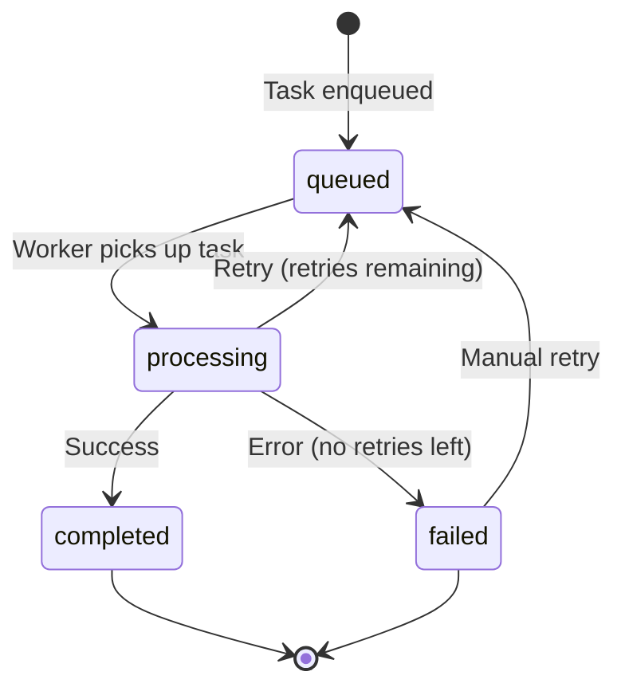

# Processing Pipeline

**PLAGIX v1.0**  
**Status:** Architecture planning  
**Last updated:** 16 November 2026

---

## Purpose

This document details the processing pipeline from file upload through final grading, including validation, extraction, analysis stages, failure handling, and retry behavior.

---

## Pipeline Overview

```mermaid
graph TD
    Start([Teacher uploads files]) --> Validate[File Validation]
    Validate -->|Valid| Store[Store in Object Storage]
    Validate -->|Invalid| Reject[Reject with Error]
    Reject --> End1([Upload failed])
    
    Store --> Ingest[Ingestion Worker]
    Ingest -->|ZIP| Extract[Extract Archive]
    Ingest -->|Individual| CreateSub[Create Submission]
    Extract --> CreateSub
    
    CreateSub --> Hash[Calculate File Hash]
    Hash -->|Duplicate| DupWarn[Warn Teacher]
    Hash -->|Unique| DocQueue[Enqueue Document Extraction]
    DupWarn --> DocQueue
    
    DocQueue --> DocWorker[Document Worker]
    DocWorker -->|Digital text| ExtractText[Extract Text + Offsets]
    DocWorker -->|Scanned| OCRCheck{OCR enabled?}
    OCRCheck -->|Yes| OCR[OCR Processing]
    OCRCheck -->|No| MarkOCR[Mark needs_ocr]
    OCR --> ExtractText
    MarkOCR --> ExtractText
    
    ExtractText --> ChunkStore[Store submission_chunks]
    ChunkStore --> CheckAll{All submissions extracted?}
    CheckAll -->|No| Wait1[Wait for more]
    CheckAll -->|Yes| RelQueue[Enqueue Relevance Analysis]
    
    RelQueue --> RelWorker[Relevance Worker]
    RelWorker --> EvalAlign[Evaluate Question Alignment]
    EvalAlign --> RelStore[Store relevance_results]
    RelStore --> CheckRel{All relevance complete?}
    CheckRel -->|No| Wait2[Wait for more]
    CheckRel -->|Yes| CompQueue[Enqueue Comparison Jobs]
    
    CompQueue --> CompWorker[Comparison Worker]
    CompWorker --> Canonical[Canonicalize Pair IDs]
    Canonical --> CalcSim[Calculate Similarity Dimensions]
    CalcSim --> FindPass[Locate Matched Passages]
    FindPass --> CompStore[Store comparisons + passages]
    CompStore --> CheckComp{All pairs complete?}
    CheckComp -->|No| Wait3[Wait for more]
    CheckComp -->|Yes| GradeQueue[Enqueue Grading Job]
    
    GradeQueue --> GradeWorker[Grading Worker]
    GradeWorker --> CalcMarks[Calculate Provisional Marks]
    CalcMarks --> GradeStore[Store grading_results]
    GradeStore --> Notify[Notify Teacher: Ready for Review]
    Notify --> End2([Processing Complete])
```



---

## Stage 1: File Validation

**Trigger:** Teacher uploads ZIP or individual files via frontend

**Responsibilities:**
- Validate file count against limits
- Validate individual file sizes
- Check file extensions against whitelist
- Verify MIME types against file content (magic bytes)
- Detect encrypted files
- Initial malware signature check (if available)

**Input:**
- Uploaded files (multipart form data)
- Evaluation ID
- Tenant ID

**Output:**
- Accepted files → stored in object storage
- Rejected files → error response with reason

**Validation Rules:**

| Check | Limit/Rule | Error Message |
|-------|-----------|---------------|
| File count | Max 500 files (configurable) | "Too many files. Maximum {limit} allowed." |
| Individual file size | Max 50 MB per file | "File {filename} exceeds size limit of {limit} MB." |
| Total upload size | Max 500 MB per evaluation | "Total upload size exceeds {limit} MB." |
| File extension | PDF, DOCX, TXT, (code files in Phase 4) | "Unsupported file type: {filename}. Allowed: PDF, DOCX, TXT." |
| MIME type | Must match extension | "File {filename} appears to be {detected_type}, not {claimed_type}." |
| Encrypted PDF | Not allowed in MVP | "File {filename} is encrypted. Please provide an unencrypted version." |

**Failure Behavior:**
- Individual file rejection does not fail entire upload
- Return detailed per-file status
- Allow teacher to retry rejected files

---

## Stage 2: Ingestion (ZIP Extraction & Submission Creation)

**Trigger:** File validation complete, files stored in object storage

**Worker:** `ingestion_worker.py`

**Responsibilities:**
- Fetch uploaded files from object storage
- Safely extract ZIP archives
- Detect and prevent malicious archives
- Calculate SHA-256 hash for each file
- Detect duplicate submissions
- Derive provisional student labels from filenames
- Create submission records in database
- Store original files in tenant-scoped object storage
- Clean up temporary extraction directories

**Input:**
- Evaluation ID
- List of uploaded file storage keys
- Optional student mapping CSV

**Output:**
- `submissions` table records
- Per-file status: accepted, duplicate, rejected, failed
- Processing job status updated

**ZIP Safety Checks:**

| Attack Vector | Detection | Mitigation |
|---------------|-----------|------------|
| Path traversal | `../` or absolute paths in member names | Reject archive, sanitize paths |
| ZIP bomb | Expansion ratio > 100:1 | Reject archive before full extraction |
| Symlinks | Archive member is symlink | Skip or reject |
| Nested archives | ZIP within ZIP (excessive depth) | Limit extraction depth to 2 levels |
| Excessive file count | More than limit inside archive | Reject archive |
| Slow extraction | Decompression time > threshold | Kill worker task, mark failed |

**Implementation Example:**
```python
def safe_extract_zip(zip_path: Path, extract_to: Path, max_size: int = 500 * 1024 * 1024):
    """Safely extract ZIP with security checks."""
    with zipfile.ZipFile(zip_path, 'r') as zf:
        # Check expansion ratio
        compressed_size = zip_path.stat().st_size
        uncompressed_size = sum(info.file_size for info in zf.infolist())
        
        if uncompressed_size > max_size:
            raise ValueError(f"Archive would expand to {uncompressed_size} bytes, exceeding limit")
        
        if compressed_size > 0 and uncompressed_size / compressed_size > 100:
            raise ValueError("Suspicious compression ratio (possible ZIP bomb)")
        
        # Extract with path sanitization
        for member in zf.infolist():
            # Skip directories, symlinks, and dangerous paths
            if member.is_dir() or member.external_attr >> 16 == 0o120000:
                continue
            
            # Sanitize filename
            safe_name = Path(member.filename).name
            if safe_name.startswith('.') or '/' in safe_name or '\\' in safe_name:
                continue
            
            # Extract to safe location
            target_path = extract_to / safe_name
            if not target_path.resolve().is_relative_to(extract_to.resolve()):
                continue  # Path traversal attempt
            
            with zf.open(member) as source, open(target_path, 'wb') as target:
                shutil.copyfileobj(source, target)
```

**Student Label Derivation:**

| Filename Pattern | Derived Label | Confidence |
|-----------------|---------------|------------|
| `john_doe_assignment.pdf` | "john_doe" | Medium |
| `12345_assignment.pdf` | "12345" | Medium |
| `Assignment - John Doe.docx` | "John Doe" | Low |
| `submission_001.pdf` | "submission_001" | Low (mark for review) |

**Duplicate Handling:**
- Calculate SHA-256 hash of file content
- Check `submissions` table for existing `(evaluation_id, file_hash)`
- If duplicate found: warn teacher, create submission with `duplicate_of` reference
- If not duplicate: proceed normally

**Failure Scenarios:**
- Corrupt ZIP → mark file as failed, continue with other files
- Malicious archive detected → reject entire archive, log security event
- Storage upload failure → retry with exponential backoff
- Database insert failure → rollback, retry task

---

## Stage 3: Document Extraction

**Trigger:** Submission record created, extraction job enqueued

**Worker:** `document_worker.py`

**Responsibilities:**
- Fetch submission file from object storage
- Detect document type (PDF, DOCX, TXT)
- Extract selectable text with page/paragraph boundaries
- Preserve character offsets for evidence tracing
- Detect scanned PDFs (low/no selectable text)
- Optionally trigger OCR for scanned content
- Store original and normalized text separately
- Update extraction status
- Handle malformed/corrupted documents gracefully

**Input:**
- Submission ID
- File storage key
- File type (PDF, DOCX, TXT)

**Output:**
- `submission_chunks` table records
- `submissions.extraction_status` updated
- Processing job status updated

**Extraction Methods:**

### PDF Extraction
```python
import fitz  # PyMuPDF

def extract_pdf_text(pdf_path: Path) -> List[SubmissionChunk]:
    chunks = []
    doc = fitz.open(pdf_path)
    
    for page_num, page in enumerate(doc, start=1):
        text = page.get_text("text")
        blocks = page.get_text("dict")["blocks"]
        
        for block_num, block in enumerate(blocks):
            if block["type"] == 0:  # Text block
                for line in block.get("lines", []):
                    original_text = " ".join(span["text"] for span in line["spans"])
                    normalized_text = normalize_text(original_text)
                    
                    chunks.append(SubmissionChunk(
                        page=page_num,
                        paragraph=block_num,
                        offset=calculate_offset(chunks),
                        original_text=original_text,
                        normalized_text=normalized_text
                    ))
    
    # Detect scanned PDF
    total_text_length = sum(len(c.original_text) for c in chunks)
    if total_text_length < 100:  # Threshold for scanned detection
        return chunks, "needs_ocr"
    
    return chunks, "completed"
```

### DOCX Extraction
```python
from docx import Document

def extract_docx_text(docx_path: Path) -> List[SubmissionChunk]:
    chunks = []
    doc = Document(docx_path)
    
    page_num = 1  # DOCX doesn't have explicit pages
    offset = 0
    
    for para_num, paragraph in enumerate(doc.paragraphs, start=1):
        if not paragraph.text.strip():
            continue
        
        original_text = paragraph.text
        normalized_text = normalize_text(original_text)
        
        chunks.append(SubmissionChunk(
            page=page_num,
            paragraph=para_num,
            offset=offset,
            original_text=original_text,
            normalized_text=normalized_text
        ))
        
        offset += len(original_text)
    
    return chunks, "completed"
```

### TXT Extraction
```python
def extract_txt_text(txt_path: Path) -> List[SubmissionChunk]:
    chunks = []
    
    with open(txt_path, 'r', encoding='utf-8', errors='replace') as f:
        content = f.read()
    
    paragraphs = content.split('\n\n')
    offset = 0
    
    for para_num, para in enumerate(paragraphs, start=1):
        if not para.strip():
            continue
        
        original_text = para.strip()
        normalized_text = normalize_text(original_text)
        
        chunks.append(SubmissionChunk(
            page=1,
            paragraph=para_num,
            offset=offset,
            original_text=original_text,
            normalized_text=normalized_text
        ))
        
        offset += len(original_text)
    
    return chunks, "completed"
```

**Text Normalization:**
```python
import unicodedata
import re

def normalize_text(text: str) -> str:
    """Normalize for comparison while preserving original."""
    # Unicode normalization (NFC for Bangla)
    text = unicodedata.normalize('NFC', text)
    
    # Lowercase
    text = text.lower()
    
    # Remove extra whitespace
    text = re.sub(r'\s+', ' ', text)
    
    # Remove punctuation (optional, configurable)
    # text = re.sub(r'[^\w\s]', '', text)
    
    return text.strip()
```

**OCR Processing (Phase 4):**
- Detect scanned pages with Tesseract or cloud OCR
- Track confidence scores per page
- Mark low-confidence extractions for teacher review
- Store OCR metadata: engine, version, confidence
- Never silently use low-confidence OCR for high-stakes accusations

**Failure Scenarios:**
- Corrupt PDF → mark extraction_status='failed', log error
- Encrypted PDF → mark extraction_status='failed', reason='encrypted'
- Malformed DOCX → attempt recovery, mark 'partial' if incomplete
- Timeout (large file) → kill task, mark failed, allow retry
- Storage fetch failure → retry with backoff

---

## Stage 4: Relevance Analysis

**Trigger:** All submissions extracted (or terminal state reached)

**Worker:** `relevance_worker.py`

**Responsibilities:**
- Evaluate each submission against question/sub-questions
- Use semantic similarity and optional rubric/reference answer
- Generate relevance category and confidence score
- Extract supporting evidence excerpts
- Store rationale and model version
- Mark low-confidence results for teacher review
- Handle multilingual content (Bangla, English)

**Input:**
- Submission ID
- Question ID
- `submission_chunks` (extracted text)
- Question prompt, rubric, reference answer (optional)

**Output:**
- `relevance_results` table record
- Category: relevant, partially_relevant, off_topic, uncertain
- Score (0.0-1.0), confidence, rationale, evidence excerpts

**Algorithm Approach:**

### Semantic Similarity Method
```python
from sentence_transformers import SentenceTransformer, util

# Use multilingual model for Bangla/English
model = SentenceTransformer('paraphrase-multilingual-mpnet-base-v2')

def analyze_relevance(submission_text: str, question_text: str, reference_answer: str = None):
    """Evaluate answer relevance using semantic similarity."""
    
    # Encode texts
    question_embedding = model.encode(question_text, convert_to_tensor=True)
    answer_embedding = model.encode(submission_text, convert_to_tensor=True)
    
    # Calculate similarity
    similarity = util.cos_sim(question_embedding, answer_embedding).item()
    
    # If reference answer provided, check alignment with it too
    if reference_answer:
        reference_embedding = model.encode(reference_answer, convert_to_tensor=True)
        ref_similarity = util.cos_sim(answer_embedding, reference_embedding).item()
        
        # Combine signals
        final_score = 0.6 * similarity + 0.4 * ref_similarity
        confidence = 0.8
    else:
        final_score = similarity
        confidence = 0.6  # Lower confidence without reference
    
    # Categorize
    if final_score >= 0.7:
        category = "relevant"
    elif final_score >= 0.4:
        category = "partially_relevant"
    elif final_score >= 0.2:
        category = "uncertain"
    else:
        category = "off_topic"
    
    # Extract evidence (top relevant sentences)
    sentences = sent_tokenize(submission_text)
    sentence_embeddings = model.encode(sentences, convert_to_tensor=True)
    sentence_scores = util.cos_sim(question_embedding, sentence_embeddings)[0]
    
    top_evidence = sorted(zip(sentences, sentence_scores), key=lambda x: x[1], reverse=True)[:3]
    evidence_excerpts = [{"text": sent, "score": float(score)} for sent, score in top_evidence]
    
    return {
        "category": category,
        "score": final_score,
        "confidence": confidence,
        "rationale": f"Answer shows {final_score:.1%} semantic alignment with question.",
        "evidence": evidence_excerpts,
        "model_version": "paraphrase-multilingual-mpnet-base-v2"
    }
```

**Relevance Categories:**

| Category | Score Range | Meaning | Teacher Action |
|----------|-------------|---------|----------------|
| `relevant` | 0.70 - 1.00 | Answer directly addresses question | Review marks normally |
| `partially_relevant` | 0.40 - 0.69 | Answer partially addresses question | Review carefully |
| `uncertain` | 0.20 - 0.39 | Unclear alignment | Manual review required |
| `off_topic` | 0.00 - 0.19 | Answer does not address question | Flag for zero marks |

**Multilingual Handling:**
- Use multilingual sentence transformer model
- Detect language if not declared
- Mark unsupported languages for manual review
- Report confidence degradation for mixed-language answers

**Failure Scenarios:**
- Model inference failure → mark status='failed', allow retry
- Out of memory → reduce batch size, retry
- Timeout → kill task, retry with smaller chunks
- Unsupported language → mark category='uncertain', confidence=0.0

**State Transition Rule:**
- Evaluation status cannot transition to "comparing" until ALL relevance tasks reach terminal state (completed or failed)

---

## Stage 5: Pairwise Comparison

**Trigger:** All relevance analysis complete

**Worker:** `comparison_worker.py`

**Responsibilities:**
- Compare every unique unordered pair in evaluation
- Calculate N×(N-1)/2 comparisons for N submissions
- Canonicalize pair IDs before storage
- Calculate multiple similarity dimensions
- Locate and extract matched passages
- Apply common-content filters
- Store one result per canonical pair
- Ensure idempotent operation (safe to retry)

**Input:**
- Evaluation ID
- List of submission IDs with extraction_status='completed'
- `submission_chunks` for all submissions
- Question text (for common-content filtering)

**Output:**
- `comparisons` table records
- `matched_passages` table records
- Comparison count: N×(N-1)/2

**Canonical Pair Logic:**
```python
def create_comparison_job(evaluation_id: UUID, submissions: List[UUID]):
    """Enqueue comparison jobs for all unique pairs."""
    n = len(submissions)
    pair_count = n * (n - 1) // 2
    
    print(f"Creating {pair_count} comparison jobs for {n} submissions")
    
    for i in range(n):
        for j in range(i + 1, n):
            # Submissions are already sorted, so submission[i] < submission[j]
            comparison_task.delay(
                evaluation_id=evaluation_id,
                submission_a_id=submissions[i],
                submission_b_id=submissions[j]
            )
```

**Comparison Task:**
```python
@celery.task(bind=True, max_retries=3)
def comparison_task(self, evaluation_id: UUID, submission_a_id: UUID, submission_b_id: UUID):
    """Compare two submissions and store canonical result."""
    
    # Canonicalize IDs
    if submission_a_id > submission_b_id:
        submission_a_id, submission_b_id = submission_b_id, submission_a_id
    
    # Check if already exists (idempotency)
    existing = db.query(Comparison).filter_by(
        evaluation_id=evaluation_id,
        submission_a_id=submission_a_id,
        submission_b_id=submission_b_id
    ).first()
    
    if existing and existing.status == 'completed':
        return existing.id  # Already done
    
    # Fetch submission chunks
    chunks_a = fetch_chunks(submission_a_id)
    chunks_b = fetch_chunks(submission_b_id)
    
    # Calculate similarity dimensions
    exact_score = calculate_exact_similarity(chunks_a, chunks_b)
    lexical_score = calculate_lexical_similarity(chunks_a, chunks_b)
    semantic_score = calculate_semantic_similarity(chunks_a, chunks_b)
    
    # Locate matched passages
    matched_passages = find_matched_passages(chunks_a, chunks_b, threshold=0.7)
    
    # Store result
    comparison = Comparison(
        evaluation_id=evaluation_id,
        submission_a_id=submission_a_id,
        submission_b_id=submission_b_id,
        exact_score=exact_score,
        lexical_score=lexical_score,
        semantic_score=semantic_score,
        status='completed'
    )
    db.add(comparison)
    db.commit()
    
    # Store matched passages
    for passage in matched_passages:
        db.add(MatchedPassage(
            comparison_id=comparison.id,
            text_a_page=passage['a_page'],
            text_a_offset=passage['a_offset'],
            text_b_page=passage['b_page'],
            text_b_offset=passage['b_offset'],
            text_a_excerpt=passage['a_excerpt'],
            text_b_excerpt=passage['b_excerpt'],
            match_type=passage['type'],
            similarity=passage['score']
        ))
    db.commit()
    
    return comparison.id
```

**Similarity Calculation Methods:**

### 1. Exact Similarity (Rabin-Karp + Winnowing)
```python
def calculate_exact_similarity(chunks_a, chunks_b, window_size=50):
    """Find exact and near-exact matches using rolling hash."""
    from winnowing import winnow
    
    text_a = " ".join(c.normalized_text for c in chunks_a)
    text_b = " ".join(c.normalized_text for c in chunks_b)
    
    # Generate fingerprints
    fingerprints_a = winnow(text_a, window_size=window_size)
    fingerprints_b = winnow(text_b, window_size=window_size)
    
    # Find common fingerprints
    common = set(fingerprints_a).intersection(set(fingerprints_b))
    
    # Calculate overlap percentage
    total_fingerprints = len(set(fingerprints_a).union(set(fingerprints_b)))
    exact_score = len(common) / total_fingerprints if total_fingerprints > 0 else 0.0
    
    return exact_score
```

### 2. Lexical Similarity (TF-IDF + Cosine)
```python
from sklearn.feature_extraction.text import TfidfVectorizer
from sklearn.metrics.pairwise import cosine_similarity

def calculate_lexical_similarity(chunks_a, chunks_b):
    """Calculate TF-IDF cosine similarity."""
    text_a = " ".join(c.normalized_text for c in chunks_a)
    text_b = " ".join(c.normalized_text for c in chunks_b)
    
    vectorizer = TfidfVectorizer()
    tfidf_matrix = vectorizer.fit_transform([text_a, text_b])
    
    similarity = cosine_similarity(tfidf_matrix[0:1], tfidf_matrix[1:2])[0][0]
    return float(similarity)
```

### 3. Semantic Similarity (Sentence Embeddings)
```python
def calculate_semantic_similarity(chunks_a, chunks_b):
    """Calculate semantic similarity using sentence embeddings."""
    from sentence_transformers import SentenceTransformer, util
    
    model = SentenceTransformer('paraphrase-multilingual-mpnet-base-v2')
    
    # Aggregate chunks into document-level embeddings
    text_a = " ".join(c.normalized_text for c in chunks_a)
    text_b = " ".join(c.normalized_text for c in chunks_b)
    
    embedding_a = model.encode(text_a, convert_to_tensor=True)
    embedding_b = model.encode(text_b, convert_to_tensor=True)
    
    similarity = util.cos_sim(embedding_a, embedding_b).item()
    return float(similarity)
```

**Common-Content Filtering:**
```python
def filter_common_content(text: str, question_text: str, boilerplate: List[str]) -> str:
    """Remove question text and known boilerplate from comparison."""
    
    # Remove question text
    text = text.replace(question_text.lower(), "")
    
    # Remove boilerplate phrases
    for phrase in boilerplate:
        text = text.replace(phrase.lower(), "")
    
    # Remove common academic phrases
    common_phrases = [
        "in this assignment",
        "according to the question",
        "as mentioned in class",
        "references:",
        "bibliography:"
    ]
    
    for phrase in common_phrases:
        text = text.replace(phrase, "")
    
    return text
```

**Failure Scenarios:**
- Database uniqueness violation → comparison already exists, skip
- Model inference failure → mark status='failed', retry
- Timeout → kill task, retry
- Storage fetch failure → retry with backoff

**Progress Tracking:**
- Total pairs: N×(N-1)/2
- Completed pairs: count of status='completed'
- Failed pairs: count of status='failed'
- Progress percentage: (completed + failed) / total × 100

---

## Stage 6: Grading

**Trigger:** All pairwise comparisons complete

**Worker:** `grading_worker.py`

**Responsibilities:**
- Calculate provisional marks based on rubric
- Use relevance results and comparison results
- Generate criterion-by-criterion scores
- Keep similarity signals separate (not auto-deducted)
- Apply configurable review thresholds
- Store suggested marks with confidence
- Prepare for teacher review

**Input:**
- Submission ID
- Relevance results
- Comparison results (similarity scores)
- Rubric criteria
- Grading policy settings

**Output:**
- `grading_results` table record
- Suggested total marks, criterion breakdown, confidence

**Grading Logic:**
```python
def calculate_provisional_marks(submission_id: UUID, evaluation_id: UUID):
    """Calculate marks based on rubric and relevance."""
    
    # Fetch data
    submission = db.query(Submission).get(submission_id)
    evaluation = db.query(Evaluation).get(evaluation_id)
    questions = db.query(Question).filter_by(evaluation_id=evaluation_id).all()
    criteria = db.query(RubricCriteria).join(Question).filter(Question.evaluation_id == evaluation_id).all()
    relevance = db.query(RelevanceResult).filter_by(submission_id=submission_id).first()
    
    # If no rubric, use relevance-only scoring
    if not criteria:
        return calculate_relevance_only_marks(submission, evaluation, relevance)
    
    # Calculate criterion-by-criterion
    criterion_scores = {}
    for criterion in criteria:
        # Use relevance + reference answer comparison
        if relevance.category == 'relevant':
            base_score = criterion.max_points * 0.85  # High marks for relevant
        elif relevance.category == 'partially_relevant':
            base_score = criterion.max_points * 0.60  # Medium marks
        elif relevance.category == 'uncertain':
            base_score = criterion.max_points * 0.40  # Low marks, needs review
        else:  # off_topic
            base_score = criterion.max_points * 0.10  # Minimal marks
        
        criterion_scores[criterion.id] = {
            "score": base_score,
            "max": criterion.max_points,
            "confidence": relevance.confidence,
            "rationale": f"Based on {relevance.category} relevance"
        }
    
    suggested_total = sum(c["score"] for c in criterion_scores.values())
    overall_confidence = relevance.confidence
    
    # Check for high similarity (integrity signal, not auto-deducted)
    high_similarity_flags = check_similarity_thresholds(submission_id, evaluation.settings)
    
    return GradingResult(
        submission_id=submission_id,
        criterion_scores=criterion_scores,
        suggested_total=suggested_total,
        confidence=overall_confidence,
        status='pending',
        metadata={"similarity_flags": high_similarity_flags}
    )
```

**Similarity Threshold Checking:**
```python
def check_similarity_thresholds(submission_id: UUID, settings: dict) -> List[dict]:
    """Check if submission exceeds similarity thresholds (for review, not auto-penalty)."""
    
    thresholds = settings.get("similarity_thresholds", {
        "lexical_high": 0.7,
        "semantic_high": 0.8,
        "exact_high": 0.5
    })
    
    flags = []
    
    # Query comparisons where this submission is involved
    comparisons = db.query(Comparison).filter(
        or_(
            Comparison.submission_a_id == submission_id,
            Comparison.submission_b_id == submission_id
        )
    ).all()
    
    for comp in comparisons:
        if comp.lexical_score >= thresholds["lexical_high"]:
            peer_id = comp.submission_b_id if comp.submission_a_id == submission_id else comp.submission_a_id
            peer = db.query(Submission).get(peer_id)
            
            flags.append({
                "type": "high_lexical_similarity",
                "peer": peer.student_label,
                "score": comp.lexical_score,
                "comparison_id": comp.id
            })
    
    return flags
```

**Failure Scenarios:**
- Missing relevance result → mark status='failed', reason='missing_relevance'
- Invalid rubric configuration → use relevance-only mode with warning
- Database write failure → retry

---

## Stage 7: Teacher Review

**Trigger:** Grading complete, teacher opens evaluation results

**Frontend Workflow:**
1. Display submission list with relevance, similarity flags, suggested marks
2. Allow filtering: high similarity, low relevance, needs review
3. Teacher clicks submission → detailed view
4. Show relevance evidence, matched passages, provisional marks
5. Teacher edits marks, dismisses flags, adds comments
6. Teacher approves final marks
7. System records changes in audit log

**No automatic worker** - this is an interactive stage.

---

## Stage 8: Report Generation

**Trigger:** Teacher requests report export

**Worker:** `report_worker.py`

**Responsibilities:**
- Generate batch summary PDF/CSV
- Generate individual submission reports
- Include approved marks, evidence, disclaimers
- Upload reports to object storage
- Provide time-limited download URLs

**Input:**
- Evaluation ID
- Report type: batch_summary, individual, csv_export

**Output:**
- PDF/CSV files stored in object storage
- Download URLs returned to frontend

---

## Failure Handling and Retry Strategy

### Celery Task Configuration
```python
@celery.task(bind=True, autoretry_for=(DatabaseError, StorageError), 
             retry_backoff=True, retry_kwargs={'max_retries': 3})
def resilient_task(self, ...):
    """Task with automatic retry logic."""
    pass
```

### Retry Behavior

| Failure Type | Retry Strategy | Max Retries | Backoff |
|--------------|----------------|-------------|---------|
| Network error | Automatic | 3 | Exponential (1s, 2s, 4s) |
| Database lock | Automatic | 5 | Exponential (0.5s, 1s, 2s, 4s, 8s) |
| Model inference error | Automatic | 2 | Fixed (5s) |
| File not found | Manual | 0 | N/A (require re-upload) |
| Corrupt file | Manual | 0 | N/A (require re-upload) |
| Timeout | Automatic | 1 | None (kill and restart) |

### Dead Letter Queue
- Tasks that fail after max retries moved to DLQ
- Admin can inspect, manually retry, or mark as permanently failed
- Teacher notified of permanent failures

---

## Idempotency Guarantees

### Comparison Task Idempotency
```python
# Check if comparison already exists before creating
existing = db.query(Comparison).filter_by(
    evaluation_id=eval_id,
    submission_a_id=min(sub_a, sub_b),
    submission_b_id=max(sub_a, sub_b)
).first()

if existing and existing.status == 'completed':
    return existing.id  # Already done, skip
```

### Database Uniqueness Constraints
- `(evaluation_id, submission_a_id, submission_b_id)` UNIQUE on comparisons
- `(submission_id, question_id)` UNIQUE on relevance_results
- `(evaluation_id, file_hash)` UNIQUE on submissions

### Processing Job Tracking
- Each job has unique ID
- Status transitions: queued → processing → completed/failed
- Re-enqueuing same job updates existing record, doesn't duplicate

---

## Performance Optimization

### Batch Processing
- Process comparisons in batches of 100 pairs per task
- Process relevance analysis in batches of 50 submissions per task
- Reduces queue overhead, improves throughput

### Caching
- Cache frequently accessed data (question text, rubric) in Redis
- Cache model embeddings for repeated inference
- TTL: 1 hour for evaluation-scoped data

### Parallel Execution
- Relevance tasks run in parallel (no dependencies)
- Comparison tasks run in parallel (no dependencies between pairs)
- Worker pool size: configurable (start with 4 workers)

---

## Monitoring and Observability

### Metrics to Track
- Average extraction time per submission
- Average comparison time per pair
- Queue depth for each task type
- Task success/failure rates
- End-to-end processing time (upload → ready for review)

### Alerts
- Queue depth > 1000 for >10 minutes
- Task failure rate > 10%
- Average task time > 2× baseline
- Worker crash or restart

### Logging
```python
logger.info(
    "Comparison completed",
    extra={
        "evaluation_id": eval_id,
        "submission_a_id": sub_a,
        "submission_b_id": sub_b,
        "lexical_score": lexical_score,
        "duration_ms": duration
    }
)
```

---

## State Machine: Job Status Transitions



---

## References

- [System Overview](system-overview.md) - Component architecture
- [Data Model](data-model.md) - Database schema
- [Requirements Traceability](../requirements/requirements-traceability.md) - FR mapping
- Celery Documentation: [Retrying tasks](https://docs.celeryq.dev/en/stable/userguide/tasks.html#retrying)
