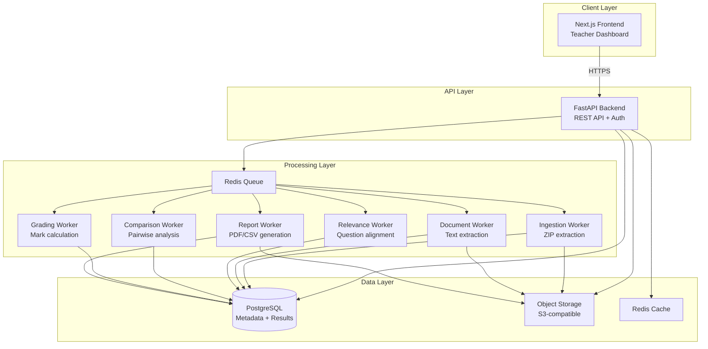
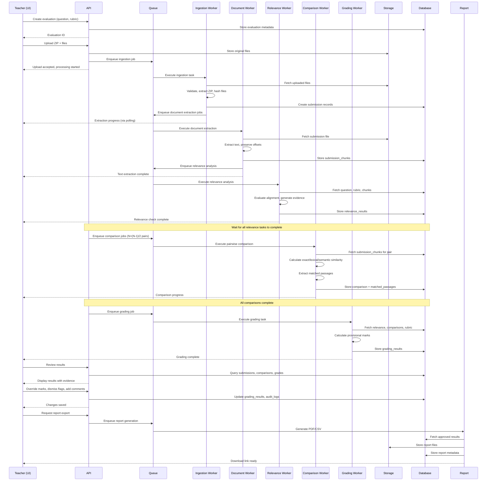
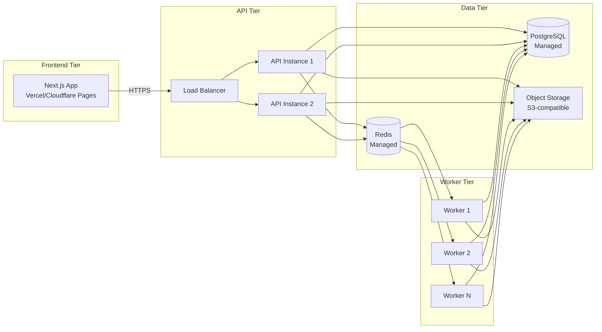
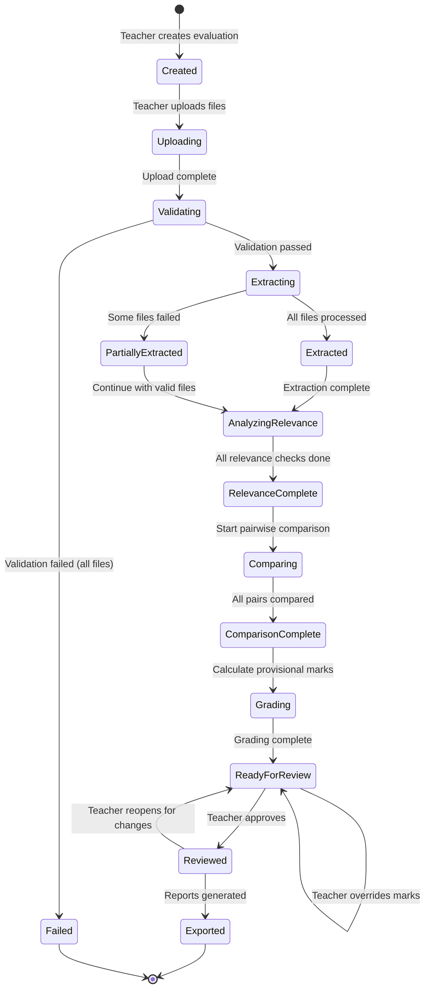

# System Overview

**PLAGIX v1.0**  
**Status:** Architecture planning  
**Last updated:** 16 November 2026

---

## Purpose

This document describes the logical architecture, component responsibilities, and end-to-end workflow for the PLAGIX platform. It serves as the high-level design reference for implementation.

---

## High-Level Architecture



---

## Component Responsibilities

### 1. Frontend (Next.js)

**Technology:** Next.js 14+, TypeScript, Tailwind CSS, shadcn/ui

**Responsibilities:**
- Teacher authentication and session management
- Evaluation creation form with question, rubric, reference answer input
- File upload interface (drag-drop, multi-select, ZIP support)
- Real-time processing progress display
- Submission review dashboard with filters and search
- Detailed submission view with relevance evidence
- Pairwise comparison view with highlighted passages
- Mark override and approval workflow
- PDF/CSV report generation triggers and downloads
- Settings and configuration management

**Key Screens:**
- Sign in / account settings
- Evaluations dashboard
- Create evaluation
- Upload submissions
- Processing view
- Evaluation results (list)
- Submission detail
- Pair comparison (side-by-side)
- Reports and exports

---

### 2. Backend API (FastAPI)

**Technology:** Python 3.11+, FastAPI, Pydantic, SQLAlchemy

**Responsibilities:**
- RESTful API endpoints for all frontend operations
- Request validation using Pydantic models
- Authentication and authorization middleware
- Tenant isolation enforcement
- Evaluation CRUD operations
- File upload handling and validation
- Job orchestration and status polling
- Query interface for results and evidence
- Teacher override and approval persistence
- Audit logging for all sensitive operations
- Rate limiting and abuse prevention

**Key API Routes:**
```
POST   /auth/login
POST   /auth/logout
GET    /evaluations
POST   /evaluations
GET    /evaluations/{id}
PATCH  /evaluations/{id}
DELETE /evaluations/{id}
POST   /evaluations/{id}/upload
GET    /evaluations/{id}/submissions
GET    /submissions/{id}
GET    /submissions/{id}/relevance
GET    /submissions/{id}/comparisons
PATCH  /submissions/{id}/grade
POST   /evaluations/{id}/reports
GET    /audit-logs
```

---

### 3. Ingestion Worker (Celery Task)

**Technology:** Python, Celery, PyMuPDF, zipfile

**Responsibilities:**
- Receive ZIP and individual file upload jobs from queue
- Validate file signatures, MIME types, extensions
- Detect and reject malicious archives (path traversal, ZIP bombs, symlinks)
- Extract ZIP contents to temporary secure location
- Calculate file hashes for deduplication
- Derive provisional student labels from filenames
- Create submission records in database
- Upload original files to object storage
- Report per-file status (accepted/rejected/failed with reason)
- Clean up temporary files after processing

**Safety Checks:**
- Maximum archive size limit
- Maximum expanded size limit
- Maximum file count per archive
- Filename sanitization (no `..`, absolute paths, null bytes)
- MIME type verification against file content

---

### 4. Document Worker (Celery Task)

**Technology:** Python, PyMuPDF, python-docx, text parsers

**Responsibilities:**
- Extract selectable text from PDF, DOCX, TXT files
- Preserve page numbers and paragraph offsets for evidence tracing
- Store original text and normalized text separately
- Detect scanned PDFs (low/no selectable text)
- Optionally trigger OCR for scanned content (Phase 4)
- Track extraction confidence and status per page
- Handle malformed or encrypted documents gracefully
- Chunk text by page/paragraph for downstream processing
- Report extraction failures with actionable error messages

**Output:**
- `submission_chunks` table: submission_id, page, paragraph, offset, original_text, normalized_text
- Extraction status: completed, partial, failed, needs_ocr

---

### 5. Relevance Worker (Celery Task)

**Technology:** Python, sentence-transformers (multilingual), scikit-learn

**Responsibilities:**
- Evaluate each submission against the question/sub-questions
- Use semantic similarity between question and answer
- Incorporate rubric criteria and reference answer when provided
- Generate relevance category: Relevant, Partially Relevant, Off-topic, Uncertain
- Calculate optional confidence score/band
- Extract supporting answer excerpts as evidence
- Store rationale and model/prompt version for reproducibility
- Mark low-confidence results for teacher review
- Handle multilingual answers (Bangla, English)
- Distinguish relevance from factual correctness

**Output:**
- `relevance_results` table: submission_id, question_id, category, score, confidence, rationale, evidence, model_version

**Rule:** Relevance analysis MUST complete before pairwise comparison begins.

---

### 6. Comparison Worker (Celery Task)

**Technology:** Python, scikit-learn (TF-IDF), sentence-transformers, n-gram/Winnowing algorithms

**Responsibilities:**
- Compare every unique unordered pair in the evaluation batch
- Calculate pair count: N × (N-1) / 2
- Canonicalize pair IDs: submission_a_id < submission_b_id
- Compute multiple similarity dimensions:
  - **Exact similarity:** Hash-based or character-level exact matches
  - **Lexical similarity:** TF-IDF + cosine similarity
  - **Semantic similarity:** Sentence embeddings + cosine similarity
- Locate and extract matched passages with page/offset
- Apply common-content filters (question text, templates, boilerplate)
- Store one result per canonical pair with uniqueness constraint
- Ensure A-B and B-A resolve to the same stored result
- Report comparison progress and failures
- Support idempotent retries without duplicate pair creation

**Output:**
- `comparisons` table: evaluation_id, submission_a_id, submission_b_id, exact_score, lexical_score, semantic_score, status
- `matched_passages` table: comparison_id, text_a_offset, text_b_offset, match_type, similarity, evidence

**Rule:** Never compare a submission with itself; enforce database unique constraint on (evaluation_id, submission_a_id, submission_b_id).

---

### 7. Grading Worker (Celery Task)

**Technology:** Python, rubric logic engine

**Responsibilities:**
- Calculate provisional marks based on rubric criteria
- Use relevance results and teacher-provided reference answer
- Generate criterion-by-criterion scores with rationale
- Keep similarity/plagiarism signals separate (not automatically deducted)
- Apply configurable review thresholds (flag high similarity)
- Generate optional penalty suggestions only when policy is explicit
- Store original suggested marks and confidence level
- Support no-rubric mode with low-confidence warning
- Prepare marks for teacher review and override

**Output:**
- `grading_results` table: submission_id, criterion_scores, suggested_total, confidence, teacher_final_score, override_reason, status

**Rule:** Similarity must be shown as separate integrity signal, not silently merged into content marks.

---

### 8. Report Worker (Celery Task)

**Technology:** Python, ReportLab/WeasyPrint for PDF, CSV writer

**Responsibilities:**
- Generate batch summary report (PDF/CSV)
- Generate individual submission reports (PDF)
- Include relevance evidence, matched passages, provisional/final marks
- Show teacher overrides and approval status
- Include disclaimers about similarity vs. plagiarism
- Export teacher-approved marks to CSV for external systems
- Store generated reports in object storage
- Provide secure time-limited download URLs

**Batch Report Contents:**
- Total submissions, accepted/rejected counts
- Relevance distribution
- High-similarity flags and strongest pairs
- Marks distribution (suggested vs. final)
- Processing failures and warnings

**Individual Report Contents:**
- Submission identity and filename
- Question relevance result with evidence
- Rubric criterion scores
- Matched peers and passages
- Integrity indicators (separate section)
- Provisional and final marks
- Teacher comments
- Disclaimer text

---

## Data Flow: End-to-End Workflow



---

## Architectural Principles

### 1. Separation of Concerns
- **Frontend:** User interaction, validation, presentation
- **API:** Request handling, authorization, orchestration
- **Workers:** Long-running compute, I/O-intensive tasks
- **Database:** Source of truth for metadata and results
- **Storage:** Large binary files (uploads, reports)

### 2. Tenant Isolation
- Every API request validates tenant/owner authorization
- Database queries filtered by tenant_id
- Object storage keys include tenant prefix
- No cross-tenant data leakage via guessed IDs or URLs

### 3. Fairness and Explainability
- Relevance precedes similarity (enforced by state machine)
- Multiple similarity dimensions kept distinct
- Matched passages traced to source page/offset
- Teacher override capability with audit trail
- No automatic accusations or mark deductions

### 4. Security by Default
- HTTPS in transit
- Encrypted credentials in environment/secret store
- File validation at multiple layers
- Safe archive extraction (no path traversal, ZIP bombs)
- Rate limiting on upload and API endpoints
- Audit logging for sensitive operations

### 5. Scalability and Reliability
- Stateless API (horizontally scalable)
- Background workers (horizontally scalable)
- Idempotent task design
- Unique constraints prevent duplicate pair records
- Job retry logic with exponential backoff
- Progress tracking independent of open connections

### 6. Modularity and Maintainability
- Algorithm implementations behind interfaces
- Service layer decouples API from business logic
- Worker tasks can be replaced/upgraded independently
- Model/prompt versions stored for reproducibility
- Clear module boundaries for testing

---

## Technology Stack Summary

| Component | Technology | Justification |
|-----------|-----------|---------------|
| **Frontend** | Next.js 14+, TypeScript | Modern React framework, SSR/SSG, TypeScript safety |
| **UI Library** | Tailwind CSS, shadcn/ui | Rapid development, accessible components |
| **Backend** | FastAPI, Pydantic | High performance, automatic validation, async support |
| **Database** | PostgreSQL 15+ | ACID compliance, unique constraints, JSON support |
| **Vector Search** | pgvector (optional) | Integrated semantic search without separate service |
| **Queue** | Redis + Celery | Battle-tested, horizontally scalable, Python integration |
| **Document Parsing** | PyMuPDF, python-docx | Reliable text extraction with offset preservation |
| **NLP** | scikit-learn, sentence-transformers | Standard tools, multilingual model support |
| **Object Storage** | S3-compatible (R2 candidate) | Cost-effective, scalable, standard API |
| **Containerization** | Docker, Docker Compose | Reproducible environments, deployment flexibility |
| **CI/CD** | GitHub Actions | Automated testing, linting, build checks |

---

## Deployment Architecture (Planned)



**Environment Separation:**
- **Local:** Docker Compose (all services)
- **Staging:** Isolated database, storage bucket, test secrets
- **Production:** Separate secrets, backups, monitoring, restricted access

---

## State Machine: Evaluation Job Lifecycle



**State Transition Rules:**
1. Relevance analysis cannot begin until extraction reaches terminal state (Extracted or PartiallyExtracted)
2. Comparison cannot begin until relevance analysis completes
3. Grading cannot begin until comparison completes
4. Teacher can override marks at any point after grading
5. Reports can be regenerated after teacher changes

---

## Security Considerations

### Authentication & Authorization
- Secure session management (JWT or server-side sessions)
- Password hashing with bcrypt/argon2
- Optional SSO integration (Google, Microsoft) in later phases
- Per-request tenant validation
- Role-based access control (teacher, admin)

### File Upload Safety
- File size limits (configurable per tenant/plan)
- File count limits per evaluation
- MIME type validation against file content (magic bytes)
- ZIP bomb detection (expanded size vs. compressed size ratio)
- Path traversal prevention (sanitize all filenames)
- Symlink detection in archives
- Malware scanning before processing (ClamAV candidate)

### Data Protection
- HTTPS enforced for all API traffic
- Database credentials in environment variables only
- Object storage presigned URLs with expiration
- Encryption at rest (provider-managed)
- No secrets in Git, logs, or browser bundles
- Audit logs for sensitive operations

### Tenant Isolation
- Database row-level security (tenant_id checks)
- Object storage key prefixes per tenant
- API authorization middleware on every route
- No cross-tenant query capabilities
- Admin access requires elevated authentication

---

## Monitoring and Observability (Planned)

### Metrics
- API request latency (p50, p95, p99)
- Worker queue depth and processing time
- Job success/failure rates
- Comparison throughput (pairs per minute)
- Storage usage per tenant
- Database connection pool saturation

### Logging
- Structured JSON logs
- Request ID tracing across services
- Error rates by endpoint and task type
- Sensitive data redaction (no full answer text in logs)
- Retention policy for operational logs

### Alerts
- High error rates
- Queue backlog exceeding threshold
- Database connection failures
- Storage quota approaching limit
- Suspicious activity (repeated failed logins, tenant isolation violations)

---

## Open Architectural Questions

See [docs/open-questions.md](../open-questions.md) for:
- Hosting provider selection (cost, region, data protection terms)
- Maximum file/ZIP size limits (benchmark before finalizing)
- OCR engine choice (Tesseract, cloud APIs, accuracy vs. cost)
- AI-writing detector integration (accuracy, privacy, false positives)
- Historical cross-batch comparison (consent, retention, privacy implications)

---

## Next Steps

1. **Phase 1 Implementation:**
   - Set up Docker Compose environment
   - Implement database schema with Alembic migrations
   - Create authentication scaffold
   - Build evaluation creation API and frontend
   - Implement file upload and ingestion worker

2. **Validation:**
   - Write integration tests for upload safety (AC-03)
   - Verify tenant isolation (AC-12)
   - Test ZIP extraction with malicious archives

3. **Documentation:**
   - Complete data model ERD
   - Document API specification (OpenAPI)
   - Write deployment runbook

---

## References

- [PLAGIX SRS v1.0](../PLAGIX_SRS_v1.0.pdf) - Complete requirements
- [Requirements Traceability](../requirements/requirements-traceability.md) - FR mapping
- [Data Model](data-model.md) - Database schema and relationships
- [Processing Pipeline](processing-pipeline.md) - Detailed worker logic
- [ADR-0001: Technology Stack](../decisions/ADR-0001-technology-stack.md) - Stack rationale
